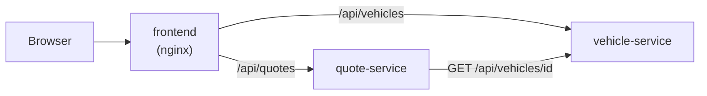
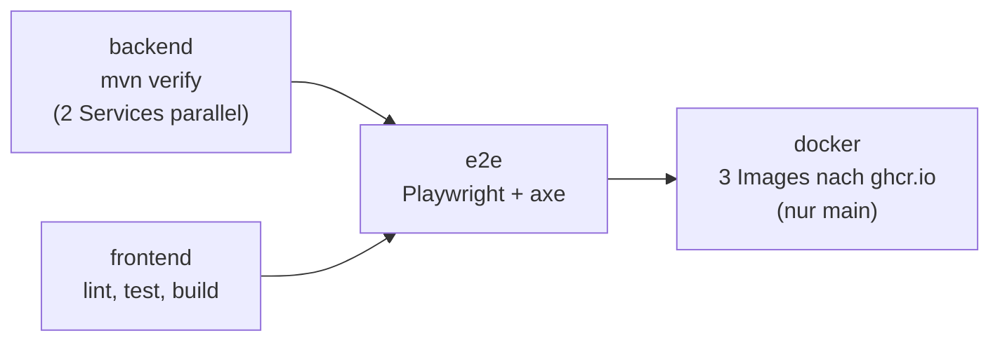

# Kfz-Tarifrechner der „Musterversicherung“

> **Demo mit erfundenen Preisen. Keine echte Versicherung.**
> Die Firma „Musterversicherung“, alle Fahrzeuge und alle Preise sind ausgedacht.

## Was macht das Projekt?

Man gibt ein Fahrzeug, das Alter, die unfallfreien Jahre und die Versicherungsart ein.
Die Anwendung berechnet einen Jahres- und Monatspreis. Sie zeigt auch, **wie** der Preis entsteht (Schritt für Schritt).

Das Projekt zeigt:

- **Microservices:** Zwei kleine Java-Dienste sprechen per REST miteinander.
- **Container und OpenShift/Kubernetes:** Alles läuft in Containern.
- **Tests:** Unit-Tests, Controller-Tests, End-to-End-Tests.
- **Barrierefreies Angular-Frontend** (WCAG 2.1 AA).

## Architektur



| Ordner | Inhalt |
|---|---|
| `vehicle-service/` | Java-Dienst: liefert die Fahrzeugliste (Port 8081) |
| `quote-service/` | Java-Dienst: berechnet den Preis (Port 8082) |
| `frontend/` | Angular-Oberfläche |
| `deploy/` | Docker- und OpenShift-Dateien |
| `docs/` | Lern- und Interview-Dokumente |

## Lokal starten

### vehicle-service

```bash
cd vehicle-service
./mvnw spring-boot:run -Dspring-boot.run.profiles=dev
```

- Alle Fahrzeuge: http://localhost:8081/api/vehicles
- Ein Fahrzeug: http://localhost:8081/api/vehicles/1
- Swagger UI (nur Profil `dev`): http://localhost:8081/swagger-ui.html
- Health: http://localhost:8081/actuator/health

Tests: `./mvnw verify`

### quote-service

```bash
cd quote-service
./mvnw spring-boot:run -Dspring-boot.run.profiles=dev
```

Tests: `./mvnw verify`

Der quote-service braucht den vehicle-service. Standard-Adresse: `http://localhost:8081`.
Andere Adresse per Umgebungsvariable: `VEHICLE_SERVICE_URL=http://anderer-host:8081`.

Beispiel-Anfrage:

```bash
curl -X POST http://localhost:8082/api/quotes \
  -H 'Content-Type: application/json' \
  -d '{"vehicleId":4,"driverAge":40,"accidentFreeYears":5,"coverage":"TEILKASKO"}'
```

Antwort (gekürzt):

```json
{ "vehicleName": "Rheinmobil Touring 500", "coverage": "TEILKASKO",
  "yearlyPrice": 456.88, "monthlyPrice": 38.07,
  "breakdown": [ { "step": 1, "description": "Grundpreis für Risikoklasse 3", "factorOrAmount": 430.00, "subtotal": 430.00 }, "..." ] }
```

### Antworten der API `POST /api/quotes`

| Status | Wann | Beispiel `detail` / `errors` |
|---|---|---|
| 200 | Alles gut | Preis + Aufschlüsselung |
| 400 | Eingabe ungültig | `errors: [{ field: "accidentFreeYears", message: "Die unfallfreien Jahre dürfen nicht größer sein als Alter minus 18." }]` |
| 400 | Fahrzeug-ID gibt es nicht | `errors: [{ field: "vehicleId", message: "Das Fahrzeug mit der ID 99 gibt es nicht." }]` |
| 503 | vehicle-service aus, zu langsam oder fehlerhaft | „Der Fahrzeugdienst ist gerade nicht erreichbar. Bitte später erneut versuchen.“ |
| 500 | Unerwarteter Fehler | allgemeiner Text, Details nur im Log |

### Frontend

Voraussetzung: Node.js 22 oder neuer. Beide Java-Services laufen (siehe oben).

```bash
cd frontend
npm install
npm start
```

Dann im Browser: http://localhost:4200
Der Angular-Dev-Server leitet `/api/vehicles` an Port 8081 und `/api/quotes` an Port 8082 weiter (`proxy.conf.json`).
Ist Port 4200 schon belegt: `npx ng serve --port 4300`.

Weitere Befehle: `npm run lint` (ESLint inkl. Barrierefreiheits-Regeln), `npm test` (Unit-Tests mit Vitest).

### End-to-End-Tests (Playwright + axe)

```bash
# 1. Java-Services einmal bauen (die Tests starten die fertigen JARs)
(cd vehicle-service && ./mvnw -q package -DskipTests)
(cd quote-service && ./mvnw -q package -DskipTests)

# 2. Einmalig den Browser installieren
cd frontend
npx playwright install chromium

# 3. Tests starten – Playwright startet beide Services und das Frontend (Port 4300) selbst
npm run e2e
```

Gegen eine schon laufende Umgebung (z. B. docker compose): `E2E_BASE_URL=http://localhost:8080 npm run e2e`.

Die Tests prüfen den ganzen Weg mit echten Backends, die Tastaturbedienung, Fehlerfälle und mit **axe-core** alle Seiten-Zustände gegen WCAG 2.1 AA (**0 Verstöße**).

### Alles mit Docker (empfohlen)

Voraussetzung: Docker mit Compose. Java oder Node braucht man dafür **nicht**.

```bash
docker compose -f deploy/docker/docker-compose.yml up --build
```

Dann im Browser: http://localhost:8080
Ist Port 8080 belegt: `FRONTEND_PORT=8090 docker compose -f deploy/docker/docker-compose.yml up --build`

Stoppen: `docker compose -f deploy/docker/docker-compose.yml down`

Der erste Build dauert einige Minuten (Maven und npm laden Abhängigkeiten). Danach geht es dank Cache schnell.
Nur das Frontend hat einen Port nach außen. Die beiden Java-Services sind nur im internen Docker-Netz erreichbar.

## CI/CD mit GitHub Actions

Die Pipeline steht in `.github/workflows/ci.yml` und läuft bei jedem Push und jedem Pull Request.



| Job | Was passiert |
|---|---|
| **backend** | `./mvnw verify` für vehicle-service und quote-service, parallel. Die JARs werden für den E2E-Job aufgehoben. |
| **frontend** | `npm ci`, `npm run lint`, `npm test`, `npm run build` |
| **e2e** | Startet beide JARs und das Frontend, dann alle Playwright-Tests inkl. axe. Bei Fehlern: HTML-Bericht als Download. |
| **docker** | Nur auf `main` und nur wenn alles grün ist: baut die 3 Images und lädt sie nach `ghcr.io/<owner>/kfz-tarifrechner-*` (Tags `latest` und Commit-Hash). |

Für das Hochladen der Images braucht man kein eigenes Secret. GitHub stellt in jedem Lauf automatisch ein `GITHUB_TOKEN` bereit.
Nach dem ersten Lauf die drei Pakete auf GitHub auf **Public** stellen, damit OpenShift sie laden darf (siehe [OPENSHIFT.md, Schritt 4c](docs/OPENSHIFT.md)).

## Deployment auf OpenShift

Die YAML-Dateien liegen in `deploy/openshift/`: ConfigMap, je ein Deployment und ein Service pro Dienst, eine Route nur für das Frontend.

```bash
oc apply -k deploy/openshift
```

Die komplette Anleitung für die kostenlose Red Hat Developer Sandbox (Konto, `oc`, Images, Fehlersuche) steht in **[docs/OPENSHIFT.md](docs/OPENSHIFT.md)**.

## Die erfundene Demo-Formel

> Diese Formel ist **ausgedacht**. Sie hat nichts mit echten Versicherungstarifen zu tun.

**Jahrespreis = Grundpreis × Altersfaktor × Deckungsfaktor × (1 − Rabatt)**, am Ende auf Cent gerundet.
**Monatspreis = Jahrespreis ÷ 12**, auf Cent gerundet.

| 1. Risikoklasse | Grundpreis pro Jahr |
|---|---|
| 1 | 300 € |
| 2 | 360 € |
| 3 | 430 € |
| 4 | 510 € |
| 5 | 600 € |

| 2. Alter | Faktor |
|---|---|
| 18–24 | 1,60 |
| 25–29 | 1,20 |
| 30–64 | 1,00 |
| 65–99 | 1,15 |

| 3. Versicherungsart | Faktor |
|---|---|
| Haftpflicht | 1,00 |
| Teilkasko | 1,25 |
| Vollkasko | 1,70 |

**4. Schadenfreiheitsrabatt:** 3 % pro unfallfreiem Jahr, höchstens 50 %.

**Beispiel:** Risikoklasse 3, 40 Jahre, Teilkasko, 5 unfallfreie Jahre
430 € × 1,00 × 1,25 × (1 − 0,15) = 456,875 € → **456,88 € pro Jahr**, 456,88 € ÷ 12 → **38,07 € pro Monat**.

**Regeln für die Eingabe:** Alter 18–99. Unfallfreie Jahre 0–50 und höchstens „Alter − 18“ (man fährt erst ab 18).

Alle Zahlen stehen in `quote-service/src/main/resources/application.yml` unter `tariff:`.

## Design-Entscheidungen

### Zwei Services statt einem

Fahrzeugdaten und Preisberechnung sind zwei verschiedene fachliche Themen. Darum gibt es zwei Services.
Jeder kann einzeln geändert, deployt und skaliert werden. Zum Beispiel ändert sich der Tarif oft, die Fahrzeugliste selten.
Für eine so kleine Anwendung wäre ein Monolith in echt einfacher. Hier geht es darum, Microservice-Kommunikation zu zeigen: REST-Aufruf, Timeouts, Fehlerbehandlung.

### Nur das Frontend ist öffentlich (nginx als Gateway)

Der Browser spricht nur mit **einer** Adresse: dem nginx im Frontend-Container. nginx liefert die Angular-Dateien aus und leitet weiter:
`/api/vehicles` → vehicle-service, `/api/quotes` → quote-service. Alles andere unter `/api/` gibt 404.

Warum?
- **Weniger Angriffsfläche:** Von außen erreicht man nur zwei API-Pfade. Actuator, Swagger und interne Endpunkte bleiben intern.
- **Kein CORS:** Seite und API haben dieselbe Adresse.
- **Austauschbar:** Die Services können intern umziehen oder skalieren. Von außen ändert sich nichts.
- Das ist ein einfaches **API-Gateway-Muster**. In größeren Systemen übernimmt das z. B. ein eigenes Gateway (Spring Cloud Gateway, Kong) oder ein Ingress.

### Container: klein, ohne Root, mit Healthcheck

- **Multi-Stage-Build:** Stufe 1 baut mit JDK/Maven bzw. Node. Stufe 2 enthält nur das Ergebnis (JRE + JAR bzw. nginx + Dateien). Frontend-Image ca. 54 MB, Java-Images ca. 350 MB.
- **Ohne Root:** Die Java-Container laufen als Nutzer 10001 in Gruppe 0. Das Frontend nutzt `nginx-unprivileged` auf Port 8080. Beides ist nötig für OpenShift, weil es Container mit einer zufälligen Nutzer-ID ohne Root-Rechte startet.
- **HEALTHCHECK:** Docker fragt regelmäßig `/actuator/health/readiness` bzw. `/healthz`. docker compose startet das Frontend erst, wenn beide Services „healthy“ sind.

### Timeouts beim Aufruf des vehicle-service

Der quote-service wartet höchstens **2 Sekunden** auf die Verbindung und höchstens **2 Sekunden** auf die Antwort.
Ohne Timeout könnte eine Anfrage sehr lange hängen. Viele hängende Anfragen blockieren alle Threads, und dann fällt auch der quote-service aus („Kaskadenfehler“).
Lieber schnell und ehrlich sagen: „Gerade nicht erreichbar“ (HTTP 503).

### Unbekannte Fahrzeug-ID → 400, nicht 404

Die URL `/api/quotes` gibt es. Falsch ist nur ein **Wert im Body**. Ein 404 würde bedeuten: „Diese Adresse gibt es nicht.“ Dann könnte das Frontend die beiden Fälle nicht unterscheiden.
Darum: 400 mit einem Feldfehler an `vehicleId`, genau wie bei anderen Eingabefehlern. Intern antwortet der vehicle-service mit 404. Der quote-service übersetzt das.

### Readiness hängt nicht vom vehicle-service ab

Wenn der vehicle-service ausfällt, bleibt der quote-service „ready“ und antwortet mit 503.
Würde er sich selbst als „nicht bereit“ melden, nähme Kubernetes ihn aus dem Verkehr. Ein Ausfall würde sich dann wie eine Kette durch alle Services ziehen.

### Barrierefreiheit (WCAG 2.1 AA) im Frontend

- Jedes Feld hat ein `<label>`. Die Radio-Buttons stehen in `<fieldset>` + `<legend>`.
- Hinweise und Fehlermeldungen sind per `aria-describedby` mit dem Feld verbunden. Fehler zeigen wir erst nach dem Verlassen des Feldes oder nach dem Absenden.
- Nach dem Absenden mit Fehlern springt der Fokus zum ersten fehlerhaften Feld.
- Nach der Berechnung springt der Fokus zur Überschrift „Ihr Ergebnis“. Eine `aria-live`-Region liest den Preis vor.
- Die Tabelle hat eine echte `<caption>` und `<th scope>`.
- Fehler erkennt man nicht nur an der Farbe: Text, Symbol ⚠ und dickerer Rahmen.
- Sichtbarer Fokus-Rahmen, Skip-Link „Zum Inhalt springen“, Kontraste mindestens 4,5:1, Klickflächen mindestens 44 px.
- **Geprüft in drei Stufen:** (1) ESLint prüft Templates beim Schreiben. (2) axe-core prüft in den E2E-Tests 6 Zustände der Seiten (0 Verstöße). (3) Ein E2E-Test bedient das ganze Formular nur mit der Tastatur. Automatische Tests finden nicht alles. Darum gehört auch ein Test mit einem echten Screenreader (z. B. NVDA) dazu.

### Keine Datenbank

Die Fahrzeuge stehen in einer festen Liste im Speicher (`InMemoryVehicleRepository`).
Das ist **Absicht**: Die Demo soll Microservices, Container und Tests zeigen, nicht Datenbank-Setup.
Ohne Datenbank startet alles in Sekunden und braucht keine Passwörter.

Mit echter Datenbank würde sich ändern:

- Eine neue Klasse (z. B. mit Spring Data JPA) implementiert das Interface `VehicleRepository`.
  Service und Controller bleiben gleich.
- Dazu kommen: Datenbank-Container, Migrationen (z. B. Flyway), Zugangsdaten als Kubernetes-Secret.
- Die Readiness-Probe prüft dann auch die Datenbankverbindung.

### Fehler als ProblemDetail

Alle Fehler kommen im Standardformat **ProblemDetail** (RFC 9457) zurück. Beispiel:

```json
{ "type": "about:blank", "title": "Fahrzeug nicht gefunden", "status": 404,
  "detail": "Es gibt kein Fahrzeug mit der ID 99.", "instance": "/api/vehicles/99" }
```

Vorteil: Jeder Client kann Fehler gleich auslesen.

### Geld mit BigDecimal, nur einmal gerundet

`double` kann viele Dezimalzahlen nicht exakt speichern (`0.1 + 0.2 = 0.30000000000000004`). Bei Geld führt das zu falschen Cents. Deshalb rechnen wir mit `BigDecimal`.
Wir runden **nur einmal am Ende** (2 Stellen, `HALF_UP` = kaufmännisch). Würde man jeden Zwischenschritt runden, könnte das Ergebnis um einen Cent abweichen.
Die Zwischensummen in der Aufschlüsselung sind nur für die Anzeige gerundet.

### Tarif-Zahlen in der Konfiguration statt im Code

Grundpreise und Faktoren stehen in `application.yml` und werden per `@ConfigurationProperties` in einen Record gelesen.
Vorteile: Fachliche Zahlen kann man ändern, ohne Code zu ändern (z. B. per Umgebungsvariable in OpenShift). Der Code bleibt allgemein.
Beim Start wird geprüft, ob die Zahlen vollständig sind (alle Risikoklassen, Alter 18–99 ohne Lücke). Wenn nicht, startet der Dienst nicht („Fail fast“).

### Swagger UI nur im Profil `dev`

Die API-Dokumentation ist praktisch beim Entwickeln. In Produktion verrät sie aber unnötig viel über die API. Deshalb ist sie dort aus.

## Was ich als Nächstes verbessern würde

_(wird am Ende ergänzt)_
