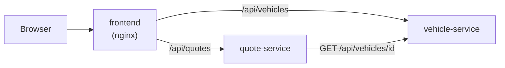

# Kfz-Tarifrechner der „Musterversicherung“

> **Demo mit erfundenen Preisen. Keine echte Versicherung.**
> Die Firma „Musterversicherung“, alle Fahrzeuge und alle Preise sind ausgedacht.

## Was macht das Projekt?

Man gibt ein Fahrzeug, das Alter, die unfallfreien Jahre und die Versicherungsart ein.
Die Anwendung berechnet einen Jahres- und Monatspreis. Sie zeigt auch, **wie** der Preis entsteht (Schritt für Schritt).

Das Projekt zeigt:

- **Microservices:** Zwei kleine Java-Dienste sprechen per REST miteinander.
- **Container und OpenShift/Kubernetes:** Alles läuft in Containern.
- **Tests:** Unit-Tests, Controller-Tests, End-to-End-Tests.
- **Barrierefreies Angular-Frontend** (WCAG 2.1 AA).

## Architektur



| Ordner | Inhalt |
|---|---|
| `vehicle-service/` | Java-Dienst: liefert die Fahrzeugliste (Port 8081) |
| `quote-service/` | Java-Dienst: berechnet den Preis (Port 8082) |
| `frontend/` | Angular-Oberfläche |
| `deploy/` | Docker- und OpenShift-Dateien |
| `docs/` | Lern- und Interview-Dokumente |

## Lokal starten

### vehicle-service

```bash
cd vehicle-service
./mvnw spring-boot:run -Dspring-boot.run.profiles=dev
```

- Alle Fahrzeuge: http://localhost:8081/api/vehicles
- Ein Fahrzeug: http://localhost:8081/api/vehicles/1
- Swagger UI (nur Profil `dev`): http://localhost:8081/swagger-ui.html
- Health: http://localhost:8081/actuator/health

Tests: `./mvnw verify`

### quote-service

```bash
cd quote-service
./mvnw spring-boot:run -Dspring-boot.run.profiles=dev
```

Tests: `./mvnw verify`

_(Die API `POST /api/quotes` kommt in Phase 3.)_

## Die erfundene Demo-Formel

> Diese Formel ist **ausgedacht**. Sie hat nichts mit echten Versicherungstarifen zu tun.

**Jahrespreis = Grundpreis × Altersfaktor × Deckungsfaktor × (1 − Rabatt)**, am Ende auf Cent gerundet.
**Monatspreis = Jahrespreis ÷ 12**, auf Cent gerundet.

| 1. Risikoklasse | Grundpreis pro Jahr |
|---|---|
| 1 | 300 € |
| 2 | 360 € |
| 3 | 430 € |
| 4 | 510 € |
| 5 | 600 € |

| 2. Alter | Faktor |
|---|---|
| 18–24 | 1,60 |
| 25–29 | 1,20 |
| 30–64 | 1,00 |
| 65–99 | 1,15 |

| 3. Versicherungsart | Faktor |
|---|---|
| Haftpflicht | 1,00 |
| Teilkasko | 1,25 |
| Vollkasko | 1,70 |

**4. Schadenfreiheitsrabatt:** 3 % pro unfallfreiem Jahr, höchstens 50 %.

**Beispiel:** Risikoklasse 3, 40 Jahre, Teilkasko, 5 unfallfreie Jahre
430 € × 1,00 × 1,25 × (1 − 0,15) = 456,875 € → **456,88 € pro Jahr**, 456,88 € ÷ 12 → **38,07 € pro Monat**.

**Regeln für die Eingabe:** Alter 18–99. Unfallfreie Jahre 0–50 und höchstens „Alter − 18“ (man fährt erst ab 18).

Alle Zahlen stehen in `quote-service/src/main/resources/application.yml` unter `tariff:`.

## Design-Entscheidungen

### Keine Datenbank

Die Fahrzeuge stehen in einer festen Liste im Speicher (`InMemoryVehicleRepository`).
Das ist **Absicht**: Die Demo soll Microservices, Container und Tests zeigen, nicht Datenbank-Setup.
Ohne Datenbank startet alles in Sekunden und braucht keine Passwörter.

Mit echter Datenbank würde sich ändern:

- Eine neue Klasse (z. B. mit Spring Data JPA) implementiert das Interface `VehicleRepository`.
  Service und Controller bleiben gleich.
- Dazu kommen: Datenbank-Container, Migrationen (z. B. Flyway), Zugangsdaten als Kubernetes-Secret.
- Die Readiness-Probe prüft dann auch die Datenbankverbindung.

### Fehler als ProblemDetail

Alle Fehler kommen im Standardformat **ProblemDetail** (RFC 9457) zurück. Beispiel:

```json
{ "type": "about:blank", "title": "Fahrzeug nicht gefunden", "status": 404,
  "detail": "Es gibt kein Fahrzeug mit der ID 99.", "instance": "/api/vehicles/99" }
```

Vorteil: Jeder Client kann Fehler gleich auslesen.

### Geld mit BigDecimal, nur einmal gerundet

`double` kann viele Dezimalzahlen nicht exakt speichern (`0.1 + 0.2 = 0.30000000000000004`). Bei Geld führt das zu falschen Cents. Deshalb rechnen wir mit `BigDecimal`.
Wir runden **nur einmal am Ende** (2 Stellen, `HALF_UP` = kaufmännisch). Würde man jeden Zwischenschritt runden, könnte das Ergebnis um einen Cent abweichen.
Die Zwischensummen in der Aufschlüsselung sind nur für die Anzeige gerundet.

### Tarif-Zahlen in der Konfiguration statt im Code

Grundpreise und Faktoren stehen in `application.yml` und werden per `@ConfigurationProperties` in einen Record gelesen.
Vorteile: Fachliche Zahlen kann man ändern, ohne Code zu ändern (z. B. per Umgebungsvariable in OpenShift). Der Code bleibt allgemein.
Beim Start wird geprüft, ob die Zahlen vollständig sind (alle Risikoklassen, Alter 18–99 ohne Lücke). Wenn nicht, startet der Dienst nicht („Fail fast“).

### Swagger UI nur im Profil `dev`

Die API-Dokumentation ist praktisch beim Entwickeln. In Produktion verrät sie aber unnötig viel über die API. Deshalb ist sie dort aus.

## Was ich als Nächstes verbessern würde

_(wird am Ende ergänzt)_
