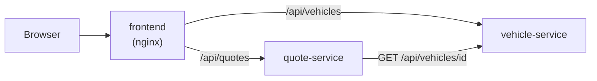

# Kfz-Tarifrechner der „Musterversicherung“

> **Demo mit erfundenen Preisen. Keine echte Versicherung.**
> Die Firma „Musterversicherung“, alle Fahrzeuge und alle Preise sind ausgedacht.

## Was macht das Projekt?

Man gibt ein Fahrzeug, das Alter, die unfallfreien Jahre und die Versicherungsart ein.
Die Anwendung berechnet einen Jahres- und Monatspreis. Sie zeigt auch, **wie** der Preis entsteht (Schritt für Schritt).

Das Projekt zeigt:

- **Microservices:** Zwei kleine Java-Dienste sprechen per REST miteinander.
- **Container und OpenShift/Kubernetes:** Alles läuft in Containern.
- **Tests:** Unit-Tests, Controller-Tests, End-to-End-Tests.
- **Barrierefreies Angular-Frontend** (WCAG 2.1 AA).

## Architektur



| Ordner | Inhalt |
|---|---|
| `vehicle-service/` | Java-Dienst: liefert die Fahrzeugliste (Port 8081) |
| `quote-service/` | Java-Dienst: berechnet den Preis (Port 8082) |
| `frontend/` | Angular-Oberfläche |
| `deploy/` | Docker- und OpenShift-Dateien |
| `docs/` | Lern- und Interview-Dokumente |

## Lokal starten

### vehicle-service

```bash
cd vehicle-service
./mvnw spring-boot:run -Dspring-boot.run.profiles=dev
```

- Alle Fahrzeuge: http://localhost:8081/api/vehicles
- Ein Fahrzeug: http://localhost:8081/api/vehicles/1
- Swagger UI (nur Profil `dev`): http://localhost:8081/swagger-ui.html
- Health: http://localhost:8081/actuator/health

Tests: `./mvnw verify`

_(Weitere Dienste folgen in den nächsten Phasen.)_

## Design-Entscheidungen

### Keine Datenbank

Die Fahrzeuge stehen in einer festen Liste im Speicher (`InMemoryVehicleRepository`).
Das ist **Absicht**: Die Demo soll Microservices, Container und Tests zeigen, nicht Datenbank-Setup.
Ohne Datenbank startet alles in Sekunden und braucht keine Passwörter.

Mit echter Datenbank würde sich ändern:

- Eine neue Klasse (z. B. mit Spring Data JPA) implementiert das Interface `VehicleRepository`.
  Service und Controller bleiben gleich.
- Dazu kommen: Datenbank-Container, Migrationen (z. B. Flyway), Zugangsdaten als Kubernetes-Secret.
- Die Readiness-Probe prüft dann auch die Datenbankverbindung.

### Fehler als ProblemDetail

Alle Fehler kommen im Standardformat **ProblemDetail** (RFC 9457) zurück. Beispiel:

```json
{ "type": "about:blank", "title": "Fahrzeug nicht gefunden", "status": 404,
  "detail": "Es gibt kein Fahrzeug mit der ID 99.", "instance": "/api/vehicles/99" }
```

Vorteil: Jeder Client kann Fehler gleich auslesen.

### Swagger UI nur im Profil `dev`

Die API-Dokumentation ist praktisch beim Entwickeln. In Produktion verrät sie aber unnötig viel über die API. Deshalb ist sie dort aus.

## Was ich als Nächstes verbessern würde

_(wird am Ende ergänzt)_
